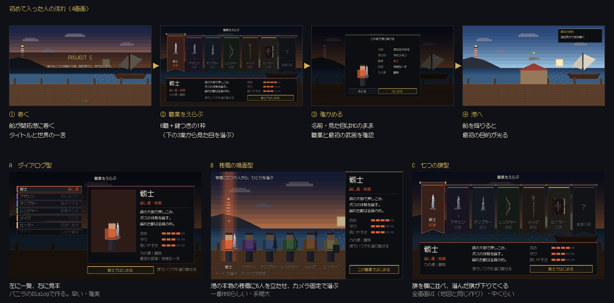
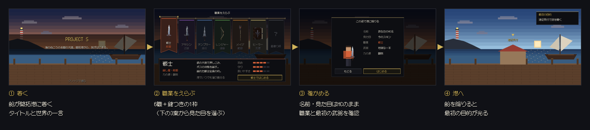

# 初めて入った人の画面（2026-10 方向案）

藍の言葉：「サーバー最初にはいったときの画面みたいなのも作っときたいな　職業選択とかそういうMMOの最初によくあるようなやつ」

**状態：藍の判断待ち。職業選択を A／B／C のどれで作り込むか。** コードはまだ変えていない。



## 流れ（4画面）



1. **着く**：船が開拓港に着く。タイトルと世界の一言。クリックで進む。
2. **職業をえらぶ**：6職と、鍵つきの1枠（星織り師。メイジLv20で解放）。
3. **確かめる**：名前と見た目は Minecraft のまま。職業と最初の武器（PR #156 の地味版）を確認して「はじめる」。
4. **港へ**：船を降りると、最初の目的「遠征受付で話を聞く」が光る。

## 職業選択の見た目 3案

| 案 | 作り | 手間 |
|---|---|---|
| A ダイアログ型 ([画像](option-a-dialog.png)) | 左に一覧、右に見本。バニラの Dialog（`CorePartyDialogs` と同じ作り） | 小。早くて確実 |
| B 桟橋の場面型 ([画像](option-b-dock.png)) | 港の本物の桟橋に6人を立たせ、カメラを固定して選ぶ（web-ui-lab `UiSessions`） | 大。一番MMOらしい |
| C 七つの旗型 ([画像](option-c-banners.png)) | 旗を横に並べ、選んだ旗が下りてくる。全画面UI（開拓大陸の地図と同じ作り） | 中 |

背景と人の絵は仮の絵。実装では本物の港とプレイヤーのスキンになる。文字は HUD と同じ 12px のドットフォント（x12y12pxMaruMinya）。

## 今の初回ログイン（調べた結果）

- `CoreLoopServer` の `PlayerSpawnEvent` で、`journey.chosen` が false ならチェスト7マスの `menus.career` を開く。
- 既定は `CoreJourney(job = WARRIOR, chosen = false)`。選ぶと `CoreAction.ChooseClass` が地味版の初期武器を渡す。
- 職業を選ぶまで遠征には出られない。港でいつでも選び直せる。

## 作り直し方

`.tools/core-menu/x12y12pxMaruMinya.ttf` が要る。このフォルダで次を実行する。

```bash
python3 first_join_mock.py && python3 sheet.py
```
